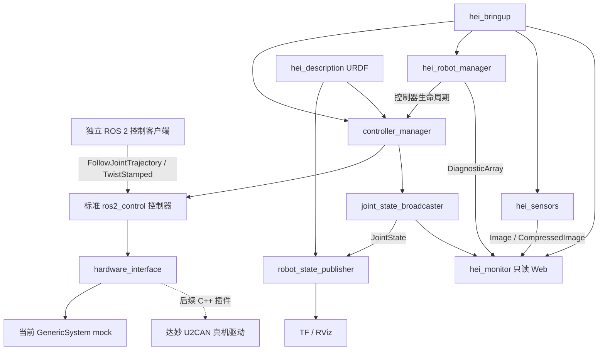

# HEI ReBot Lift ROS 2 本地系统架构

日期：2026 年 10 月 19 日。当前主线采用 ROS 2 原生软件栈；此前非 ROS 的 Python 原型、配置、测试与入口已清理，所有运行代码统一位于 `ros2_ws/src`。用户已确认 Web 仅作只读监控。

## 架构

主要包边界参考 [ROBOTIS AI Worker](https://github.com/ROBOTIS-GIT/ai_worker/tree/main) 的 description、bringup、控制器与 manager 组织。HEI 采用自己的模型、关节、升降和 O 型全向轮配置，不使用 ROBOTIS 的 DYNAMIXEL 或 swerve 控制器参数。

`controller_manager` 和标准控制器运行控制更新；Python manager 负责启停、状态检查和诊断，不承担电机实时环。`hei_monitor` 已改为原生 Rust/rclrs 节点，只订阅 ROS 数据，与动作通路分离。`ros.rs` 管理订阅，`cache.rs` 管理状态，`http.rs` 使用 Axum 提供只读 API；`main.rs` 启动 ROS executor 线程及 Tokio HTTP 服务。前端静态资源嵌入二进制，launch 入口保持不变。相机节点独立执行，采用 sensor-data QoS 与有界最新图像缓存。

## 当前实现

| 包 | 当前职责 | 实现状态 |
| --- | --- | --- |
| hei_description | 原始 HEI 几何/运动学、21 个可动关节、19 个独立命令接口、TF、RViz | 已实现；模型来源与改动随包记录 |
| hei_control | 双臂各六关节、两只夹爪、升降 JTC 与全向底盘控制器 | mock 配置已启动验证 |
| hei_robot_manager | ListControllers/SwitchController 管理、显式启停、陈旧反馈时请求停用、diagnostics | Python 原生 ROS 节点 |
| hei_sensors | 三路模拟或 OpenCV 相机、Image/CompressedImage、逐相机诊断 | 模拟已联调；真实相机未连接验证 |
| hei_monitor | JointState、Odometry、图像和 diagnostics 订阅及只读 HTTP | Rust/rclrs + Axum；无控制 publisher/client |
| hei_bringup | robot_state_publisher、controller_manager、spawner 和本地节点统一启动 | 默认 motion inactive；关键节点退出时结束 launch |

没有创建仅能编译但不能使用的硬件插件。当前只有 `mock_components/GenericSystem`；之后以 `hei_hardware` 对接物理设备。其作用是验证 ROS 2 接口管线，不提供接触物理、传感器真实性或实际停止保证。[官方 mock 说明](https://control.ros.org/jazzy/doc/ros2_control/hardware_interface/doc/mock_components_userdoc.html)

## 接口与单位

关节名保留 URDF 原名：`a_right_joint1..6`、`b_left_joint1..6`、`lift_joint`、左右夹爪主指与 mimic 指、四个 wheel joint。机械臂和轮角为 rad，夹爪指位移与升降为 m。旧 LeRobot 18 维接口的电机角度、mm、缩放底盘速度需在独立适配层转换。

双臂、夹爪和升降使用标准 `FollowJointTrajectory`。底盘使用 `TwistStamped`，输出 Odometry；几何尺寸和轮序符号尚未校准，不发布定位 TF。相机没有已验证标定时，不发布假 CameraInfo。控制器参数以 [hei_control 配置](/home/cw/gitdir/easeBot/ros2_ws/src/hei_control/config/controllers.yaml) 为准。

## 启动与停止

1. 发布机器人描述，初始化 mock hardware 与 controller_manager。
2. 激活 joint_state_broadcaster，发布状态与 TF。
3. 加载并配置六个运动控制器，保持 inactive。
4. 独立客户端调用 manager 的 `set_enabled` 激活控制器，再发送标准动作。
5. `stop` 停用运动控制器，状态广播器保留；Web 不提供此操作。

manager 的停用请求不等于真实电机失能，也不是硬件急停。mock hardware 初始化可处于 active，运动控制器仍为 inactive；这两个生命周期不能混为一谈。启用真实硬件时，需要另行定义硬件连接、使能、回零与承载停止策略。

## 当前边界和后续顺序

本次未复刻旧版统一控制租约。ROS 原生轨迹执行有自己的 action 生命周期；同一 domain 内可直接访问标准控制器。manager 提供开发便利与状态检查，不是经验证的硬件保护控制器。需要部署 SROS2 或等效访问策略，才能将 Web 的只读约定扩大为整个 ROS graph 的访问隔离。

后续按以下顺序推进：

1. 实现达妙硬件插件，验证反馈新鲜度、单位、线程/串口超时与连接失败清理。
2. 为升降限位与回零、双臂/夹爪停止、主机失效和硬件急停建立实际测试。
3. 增加受控命令入口与仲裁，明确 action、遥操作和策略的抢占/取消语义。
4. 上机核验 ROS 发行版、JetPack 和硬件资源，增加服务部署与恢复。
5. 接入 VR/LeRobot，随后再考虑 MoveIt 与导航。

本机以 Jazzy 验证，不代表 Jetson 目标机天然兼容。Humble、不同 JetPack 和真实相机/串口均需独立验证。
