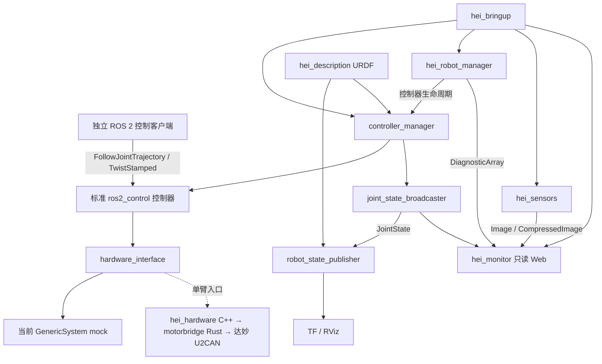

# HEI ReBot Lift ROS 2 本地系统架构

本文描述机器人侧 ROS 2 软件栈，其源码位于 `ros2_ws/src`。用户已确认 Web 仅作只读监控。
服务器侧策略执行器是独立的 [agent Python 项目](../agent/README.md)，不属于 ROS 包，
通过 pip 安装。机器人侧 `hei_agent_bridge` 是 ROS 与 MHS 的适配边界；默认只读，
可通过独立 `agent_skills.launch.py` 显式启动 skill set。服务器可发现其版本化目录并调用
状态、命名位姿和夹爪技能；默认技能配置为 mock，真实点位需单独提供。
Agent 可用 `--backend embedded --serve` 常驻运行内置 Hub，发布进程内 mDNS/DNS-SD；
机器人默认 `hub_url=auto`，按可选 hub_id 与设备 ID 自动发现后注册。双方复用
`packages/hei-discovery`，不依赖 Avahi/D-Bus。图执行与 Hub 生命周期独立，断线恢复连接
但不重放运动；显式 hub_url 可绕过发现。细节见 [Agent 文档](../agent/README.md#使用机器人发布的-skill-set)。

## 架构

主要包边界参考 [ROBOTIS AI Worker](https://github.com/ROBOTIS-GIT/ai_worker/tree/main) 的 description、bringup、控制器与 manager 组织。HEI 采用自己的模型、关节、升降和 O 型全向轮配置，不使用 ROBOTIS 的 DYNAMIXEL 或 swerve 控制器参数。

`controller_manager` 和标准控制器运行控制更新；Python manager 负责启停、状态检查和诊断，不承担电机实时环。`hei_monitor` 已改为原生 Rust/rclrs 节点，只订阅 ROS 数据，与动作通路分离。`ros.rs` 管理订阅，`cache.rs` 管理状态，`http.rs` 使用 Axum 提供只读 API；`main.rs` 启动 ROS executor 线程及 Tokio HTTP 服务。前端静态资源嵌入二进制，launch 入口保持不变。相机节点独立执行，采用 sensor-data QoS 与有界最新图像缓存。`hei_sensors` 已使用 rclpy LifecycleNode，三路共用生命周期；configure 打开设备，activate 才开始采集发布，deactivate 停止采集，cleanup 关闭设备。普通诊断发布器在非 active 状态仍工作。默认 bringup 自动 configure/activate 一次。

## 当前实现

| 包 | 当前职责 | 实现状态 |
| --- | --- | --- |
| hei_description | 原始 HEI 几何/运动学、21 个可动关节、19 个独立命令接口、TF、RViz | 已实现；模型来源与改动随包记录 |
| hei_control | 双臂各六关节、两只夹爪、升降 JTC 与全向底盘控制器 | mock 配置已启动验证 |
| hei_hardware | motorbridge 硬件系统与标准夹爪控制器两个插件 | 原生 SystemInterface；单臂默认只读，PTY 联调，真实电机待测 |
| hei_robot_manager | ListControllers/SwitchController 管理、显式启停、陈旧反馈时请求停用、diagnostics | Python 原生 ROS 节点 |
| hei_sensors | 三路模拟或 OpenCV 相机、Image/CompressedImage、逐相机诊断 | LifecycleNode；模拟和转换流程已联调，真实相机未连接验证 |
| hei_monitor | JointState、Odometry、图像和 diagnostics 订阅及只读 HTTP | Rust/rclrs + Axum；无控制 publisher/client |
| hei_agent_bridge | ROS 状态、JPEG 与显式启用的本地 skill set | 默认只读；可独立接入 ROS actions，见技能 README |
| hei_bringup | robot_state_publisher、controller_manager、spawner 和本地节点统一启动 | 默认 motion inactive；关键节点退出时结束 launch |

默认整机入口使用 `mock_components/GenericSystem`，验证 ROS 2 接口管线。[官方 mock 说明](https://control.ros.org/jazzy/doc/ros2_control/hardware_interface/doc/mock_components_userdoc.html)

底层串口和协议由固定版本 motorbridge 提供，Rust 私有 C ABI 保留逐帧故障锁存及无失能副作用的只读关闭；机器人 YAML 位于 `hei_bringup/config/`。`hei_hardware/DamiaoSystem` 与独立 `damiao_arm.launch.py`，默认接入选定侧六轴与 motor7，共用一个串口；夹爪作为原始电机 GPIO 资源，不把电机角度写进米制指关节。默认只读查询；显式打开命令接口后，控制器仍为 inactive，六轴占用接口时请求使能；夹爪占用接口后等待目标再使能。驱动检测固件控制模式、反馈超时与错误码，错误锁存后尽力失能已占用电机。硬件 activate、控制器 active、物理电机 enabled 分别处理。此入口不启动 mock manager，真实设备连接和承载停止仍需上机验证，见 [硬件包说明](../ros2_ws/src/hei_hardware/README.md)。

## 接口与单位

关节名保留 URDF 原名：`a_right_joint1..6`、`b_left_joint1..6`、`lift_joint`、左右夹爪主指与 mimic 指、四个 wheel joint。机械臂和轮角为 rad，夹爪指位移与升降为 m。旧 LeRobot 18 维接口的电机角度、mm、缩放底盘速度需在独立适配层转换。

整机 mock 中双臂、夹爪和升降使用标准 `FollowJointTrajectory`。真实共享总线夹爪控制器提供标准 `GripperCommand`，牛顿目标需要力标定；位置调试预设允许 max_effort=0 的限流开度控制，未标定力时反馈 NaN。内部电机限位为 [-4.5,0] rad，速度和超时由控制器参数管理。成功后保持限流位置，取消/超时只停止夹爪，同侧硬件故障停止整侧。底盘使用 `TwistStamped`，输出 Odometry；几何尺寸和轮序符号尚未校准，不发布定位 TF。相机没有已验证标定时，不发布假 CameraInfo。控制器参数以 [hei_control 配置](/home/cw/gitdir/easeBot/ros2_ws/src/hei_control/config/controllers.yaml) 为准。

## 启动与停止

1. 发布机器人描述，初始化 mock hardware 与 controller_manager。
2. 激活 joint_state_broadcaster，发布状态与 TF。
3. 加载并配置六个运动控制器，保持 inactive。
4. 独立客户端调用 manager 的 `set_enabled` 激活控制器，再发送标准动作。
5. `stop` 停用运动控制器，状态广播器保留；Web 不提供此操作。

manager 的停用请求不等于真实电机失能，也不是硬件急停。mock hardware 初始化可处于 active，运动控制器仍为 inactive；这两个生命周期不能混为一谈。启用真实硬件时，需要另行定义硬件连接、使能、回零与承载停止策略。

## 当前边界和后续顺序

本次未复刻旧版统一控制租约。ROS 原生轨迹执行有自己的 action 生命周期；同一 domain 内可直接访问标准控制器。manager 提供开发便利与状态检查，不是经验证的硬件保护控制器。需要部署 SROS2 或等效访问策略，才能将 Web 的只读约定扩大为整个 ROS graph 的访问隔离。

后续按以下顺序推进：

1. 在已通过 PTY 测试的达妙插件上，分阶段验证真实只读反馈、校准、单关节运动与实际停止；默认 mock 不受影响。
2. 为升降限位与回零、双臂/夹爪停止、主机失效和硬件急停建立实际测试。
3. 增加受控命令入口与仲裁，明确 action、遥操作和策略的抢占/取消语义。
4. 上机核验 ROS 发行版、JetPack 和硬件资源，增加服务部署与恢复。
5. 接入 VR/LeRobot，随后再考虑 MoveIt 与导航。

本机以 Jazzy 验证，不代表 Jetson 目标机天然兼容。Humble、不同 JetPack 和真实相机/串口均需独立验证。

双侧夹爪调试入口 `grippers.launch.py` 为每侧分别创建共享总线系统，将六轴设为只有状态接口、自动激活夹爪控制器。正式 `damiao_arm.launch.py` 默认完全只读，但仍加载 inactive 的夹爪 Action Server；完整可写模式仍由操作者分别激活两种控制器。位置调试允许在力未标定时使用标准 Action 的 max_effort=0，以配置电流上限运行、力反馈 NaN；正数牛顿目标仍要求有效标定。

双侧夹爪调试通过 `grippers.launch.py` 组合两个隔离的单侧入口，统一 `/hei` namespace，`/hei/left_controller_manager` 与 `/hei/right_controller_manager` 各管理一条七电机总线。广播器、状态发布节点和硬件实例也分别命名；robot_description、joint_states、dynamic_joint_states 和 TF 话题在 `/hei` 下使用 left_/right_ 前缀，六轴仍只读。
